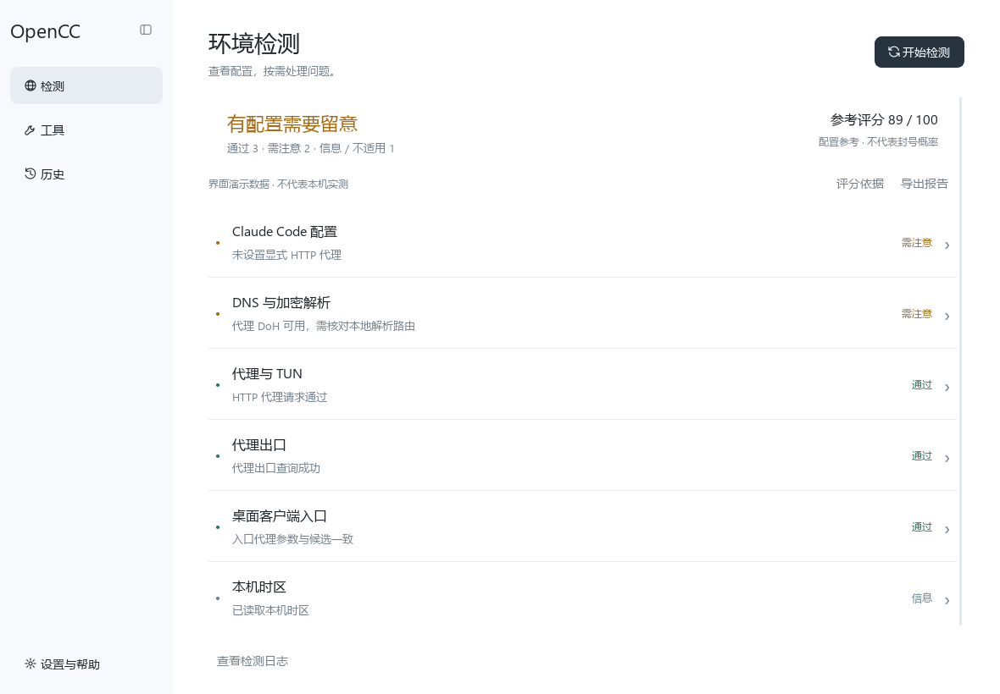

# OpenCC-Env 0.3 环境工作台

Windows 环境配置诊断与可还原维护工具。支持 Windows x64，参考评分用于说明配置检查结果，不代表账号风险或封号概率。

[下载 Windows 程序](https://github.com/staryu5463/opencc-env/releases/latest) · [MIT 许可证](LICENSE) · [第三方许可](THIRD_PARTY_NOTICES.md)



下载发布页中的完整 ZIP，解压后运行 `OpenCC-Env.exe`；无需安装 Python。也提供单文件 EXE。EXE 尚未代码签名；校验值随版本发布。程序不要求关闭 Defender 或添加安全排除项。

界面采用检测、工具、历史三项主导航；设置与帮助位于侧栏底部。取消常驻环境底栏，参数和评分在检测行内展开。支持完整参数、原始数据、复制、打开目录、就地预览与复查；F5 重新检测，Esc 收起，Ctrl+E 导出。窄窗口自动收起导航，界面偏好独立保存在本机 OpenCC-Env/interface.json。

修改前检查本轮检测与预览之间的代理、配置变化；变化时停止写入。测试使用临时配置验证保存、快照、复查与逐字节还原，不操作真实用户配置。

构建使用 build.py。

## 功能与范围

Windows 本地环境诊断与可还原配置工具。默认使用普通用户权限，浅色界面，可切换深色。
本工具的分数是自定义配置参考模型，不是封号概率，也不保证账号安全或服务使用资格。

## 主要变化

- 首页优先展示实际状态；错误、不适用和信息项有独立状态。
- 时区由 Windows 实际读取，位于本机时区项目的展开详情，不会自动切换台北。
- 检测行内提供关键参数、完整参数、原始数据、权重和扣分，支持报告导出。
- 代理端口自动发现，可通过 OPENCC_PROXY 指定 HTTP/HTTPS 代理；验证请求禁止自动直连回退。
- CLI 修复仅写入用户级 .claude/settings.json，保留其他内容，不改 Windows 全局变量。
- 快捷方式使用系统真实桌面路径，修改代理参数时保留其他参数。
- 缓存移动到隔离目录，不永久删除、强杀进程或清理 CLI 用户缓存。
- 当前用户 Run 启动项必须明确选择、先备份再停用；其他启动来源不在此功能覆盖范围。
- 快照逐次保留、原子写入；备份失败停止修改；外部变化会阻止覆盖还原。
- 旧格式快照保留供查看，不支持自动还原；缺少可信原始值的记录不会用于覆盖还原。
- 日志按需展开；检测和写入操作互斥，窗口等待活动操作结束后关闭。

## 运行与构建

建议使用 Windows x64 与 Python 3.11。依赖版本固定为首次发布的构建版本；升级依赖后应重新验证。

```powershell
python -m venv .venv
.\.venv\Scripts\Activate.ps1
python -m pip install -r requirements.txt
python -m opencc_env.main
python -m unittest discover -s tests -v
python build.py
```

运行依赖 PySide6；构建依赖 PyInstaller。构建后先运行打包 EXE 的隔离界面自检，通过后才写入 dist。
构建不清空旧产物；旧 EXE 保留在 previous 目录中。
构建包含第三方许可资源，并排除本工作台不使用的虚拟键盘和 PDF 插件。完整对应库源码随 Release 提供；修改库和重新构建的说明见 THIRD_PARTY_NOTICES.md。

```powershell
# 指定自定义 HTTP/Mixed 端口，仅影响从该终端启动的本工具
$env:OPENCC_PROXY = 'http://127.0.0.1:8989'
python -m opencc_env.main

# 无网络、无系统设置写入的界面与打包自检；截图使用明确标记的演示数据
python -m opencc_env.main --self-test-output .\verification\result.json
```

## 评分模型

原始权重：网络 35，代理 25，DNS 25，CLI 25，快捷方式 25；时区只展示、不计分。
不适用项目不计入分母。归一化占比 = 项目权重 / 本轮适用项目总权重。
总分 = 向下取整(加权得分 / 适用项目权重总和)。
任何项目无法完成检测时不展示总分；明确失败始终显示“有问题”，不能被高分掩盖。
严重度与权重是工具作者的配置模型选择，没有经过账号风险数据校准。

## 检测与还原边界

- IP 地理信息不能证明住宅、独享、信誉或使用资格；出口请求也不能证明 Claude 分流路径一致。
- 网卡存在、Up 状态和端口可连接不是全局接管证据。未开启 TUN 不单独扣分。
- DNS 配置与一次 DoH 请求不能证明无泄漏；IPv6 DNS 地址会读取，IPv6 实际流量路由未验证。
- CLI 检查当前进程继承环境和用户设置；未读取组织托管或其他项目设置，未观察实际会话请求。
- 快捷方式参数检查不代表客户端已经采用参数。MSIX、重命名及自定义目录未完全覆盖。
- 配置复查通过、缓存目录还原通过与客户端效果恢复是不同结果；开机行为另行验收。
- 普通权限、原生 API、禁用 UPX 和签名都不能保证杀毒零误报。不要求关闭 Defender 或添加排除项。
- 当前发布文件尚无代码签名。其他电脑启用 Defender、SmartScreen、Smart App Control 后的效果需要独立测试。

## 来源

- [Claude Code 网络配置](https://code.claude.com/docs/en/network-config)
- [Anthropic 支持地区政策](https://www.anthropic.com/supported-countries)
- [微软 SmartScreen 发布信誉](https://learn.microsoft.com/en-us/windows/apps/package-and-deploy/smartscreen-reputation)

## 测试安全

所有修改与还原测试使用临时文件、临时快照或注册表接口替身，不改真实用户代理、时区、启动项与客户端数据。
原生 COM 快捷方式闭环测试仅在临时目录创建入口，从不启动测试目标。
不宣称“100% 正确”“永久有效”或仅凭测试通过断言客户端效果已恢复。
